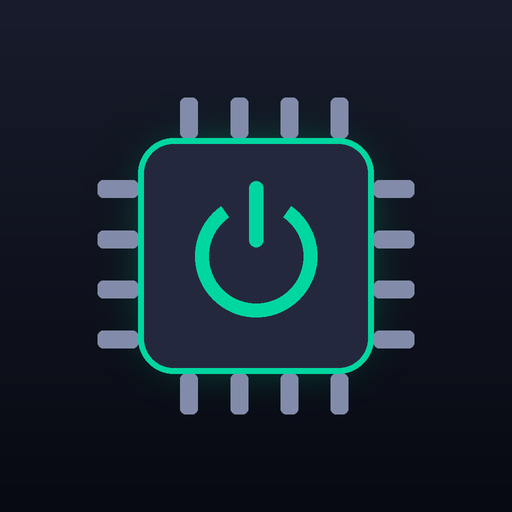
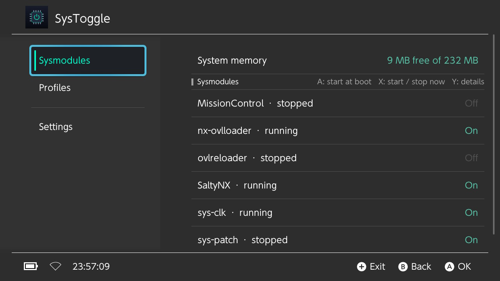
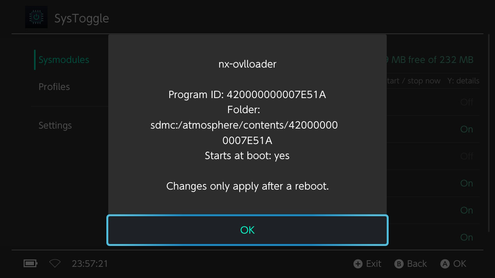
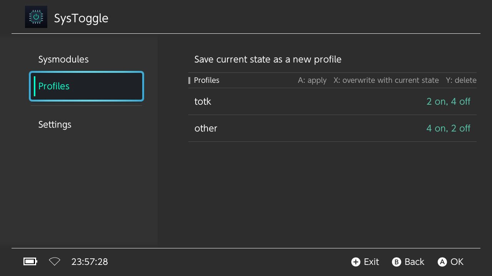
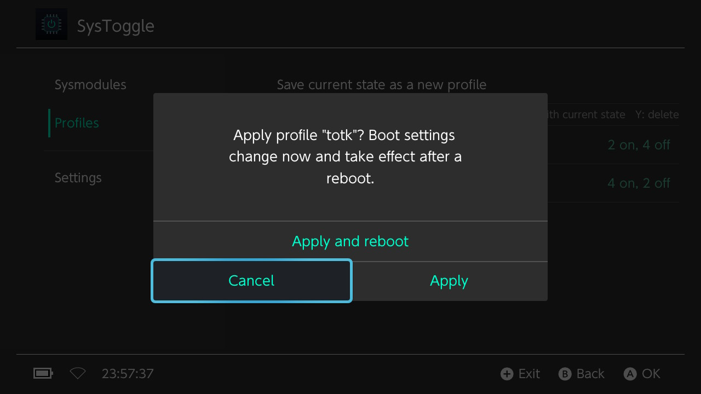
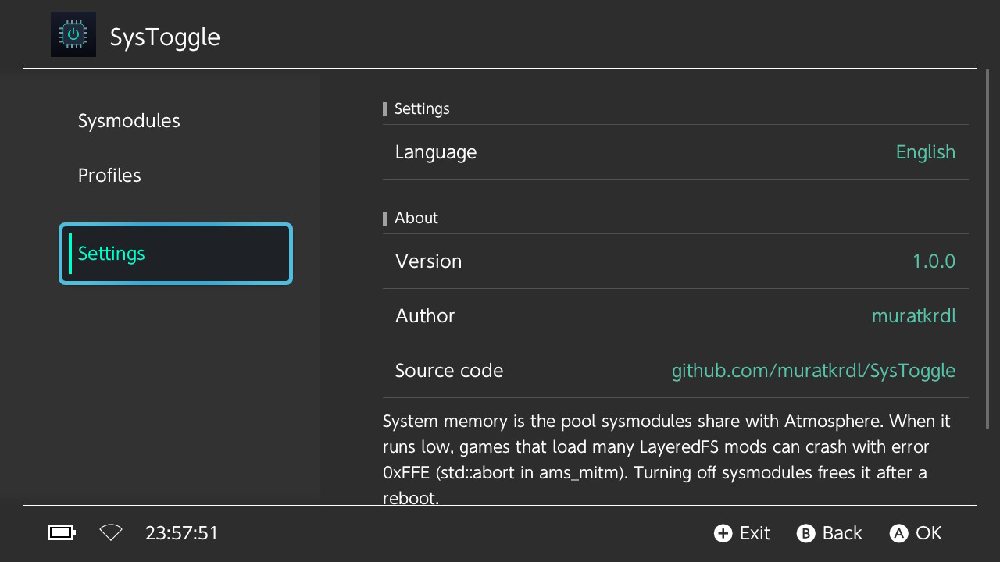
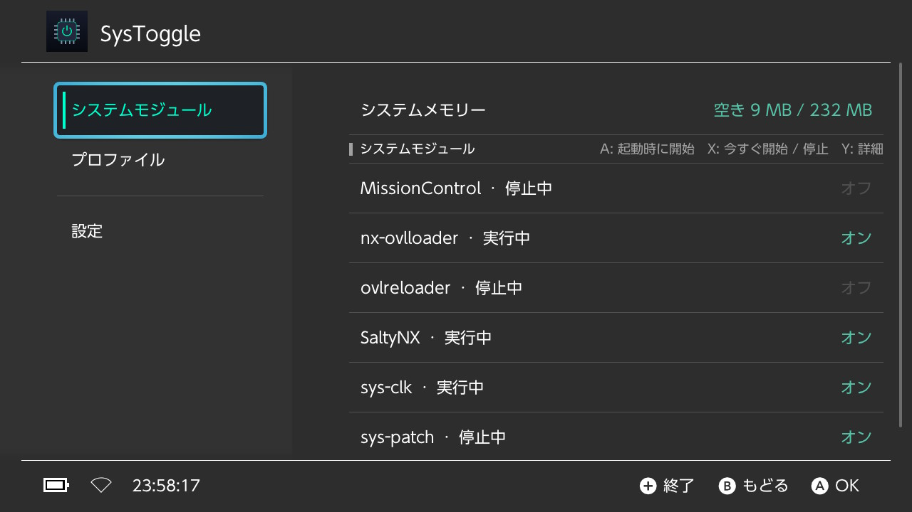

<p align="center"></p>

<h1 align="center">SysToggle</h1>

<p align="center">Turn Atmosphère sysmodules on and off right on your Switch — no PC, no MTP, no overlay loader needed.</p>

<p align="center"><a href="#türkçe">Türkçe</a> · <a href="#english">English</a></p>

<table>
  <tr>
    <td></td>
    <td></td>
  </tr>
  <tr>
    <td></td>
    <td></td>
  </tr>
  <tr>
    <td></td>
    <td></td>
  </tr>
</table>

---

## English

### Why

Sysmodules such as sys-clk, SaltyNX, MissionControl or nx-ovlloader share a small pool of system memory with Atmosphère. On recent firmware that pool is tight. Games that load many LayeredFS mods (for example *Tears of the Kingdom* translation or overhaul mods) can then crash before reaching the title screen with:

```
Program ID: 010041544d530000
Error Desc: std::abort() called (0xffe)
```

That program is Atmosphère's own `ams_mitm`, which runs out of memory while building the modded file system. The fix is to turn some sysmodules off — but the usual tool for that, the Ultrahand/Tesla *Sysmodules* overlay, needs nx-ovlloader running, which is often exactly the module you need to turn off. Modules without a `toolbox.json` (sys-clk, for example) do not even show up there.

SysToggle is a regular homebrew app (`.nro`). It needs nothing running in the background.

### Features

- **Every sysmodule** in `atmosphere/contents`, including ones without `toolbox.json`. Names come from `toolbox.json`, a list of well-known modules, or the module's own `main.npdm`.
- **Start at boot** on/off for each module (`boot2.flag`), with a one-press reboot.
- **Start / stop now** for modules that support it, with a live *running* indicator.
- **Profiles**: save the current setup (for example *TotK* and *Normal*) and switch between them with one press.
- **System memory** indicator.
- Warnings before turning off modules that affect other things (sys-patch, nx-ovlloader).
- Follows the console language: English, 日本語, Français, Deutsch, Italiano, Español, Nederlands, Português, Русский, 한국어, 简体中文, 繁體中文 — plus Türkçe, selectable in *Settings*. Translation fixes are welcome.

### Install

1. Download `SysToggle.nro` from [Releases](../../releases).
2. Copy it to `sd:/switch/`.
3. Open it from the Homebrew Menu.

Settings and profiles are stored in `sd:/config/SysToggle/`.

Tested on firmware 21.1.0 with Atmosphère 1.12.0 and 1.12.2. Questions and feedback: [GBAtemp thread](https://gbatemp.net/threads/systoggle-v1-0-0-turn-sysmodules-on-off-without-nx-ovlloader-fixes-0xffe-crashes-with-big-layeredfs-mods.686810/). Bug reports: [Issues](../../issues).

### Controls

| Tab | Button | Action |
|---|---|---|
| Sysmodules | A | Start at boot on / off |
| Sysmodules | X | Start or stop now (if supported) |
| Sysmodules | Y | Details |
| Profiles | A | Apply (optionally reboot) |
| Profiles | X | Overwrite with current state |
| Profiles | Y | Delete |
| Any | + | Exit |

### Building

Requires [devkitPro](https://devkitpro.org/wiki/Getting_Started) with `switch-dev`, `switch-glfw`, `switch-mesa` and `switch-glm`.

```sh
git clone --recursive https://github.com/muratkrdl/SysToggle.git
cd SysToggle
cmake -B build_switch -DPLATFORM_SWITCH=ON -DCMAKE_BUILD_TYPE=Release
cmake --build build_switch --target SysToggle.nro
```

Core logic tests run on a PC: `bash run_tests.sh`.

---

## Türkçe

### Neden

sys-clk, SaltyNX, MissionControl ya da nx-ovlloader gibi modüller Atmosphère ile küçük bir sistem belleğini paylaşır. Yeni firmware'lerde bu alan dar. Çok sayıda LayeredFS modu yükleyen oyunlar (örneğin *Tears of the Kingdom* çeviri ya da büyük içerik modları) daha başlık ekranına gelmeden şu hatayla çökebilir:

```
Program ID: 010041544d530000
Error Desc: std::abort() called (0xffe)
```

Bu program Atmosphère'in kendi `ams_mitm` modülü ve modlu dosya sistemini kurarken belleği bitiyor. Çözüm bazı modülleri kapatmak. Ama bunun için kullanılan Ultrahand/Tesla *Sysmodules* menüsü nx-ovlloader'ın açık olmasını gerektiriyor, ki çoğu zaman kapatılması gereken modül tam olarak o. `toolbox.json` dosyası olmayan modüller (sys-clk gibi) orada görünmüyor bile.

SysToggle normal bir homebrew uygulaması (`.nro`). Arka planda hiçbir şeyin çalışmasına ihtiyaç duymaz.

### Özellikler

- `atmosphere/contents` içindeki **bütün modüller**, `toolbox.json` olmayanlar dahil. Adlar `toolbox.json`'dan, bilinen modüller listesinden ya da modülün kendi `main.npdm` dosyasından okunur.
- Her modül için **açılışta başlat** açma/kapama (`boot2.flag`) ve tek tuşla yeniden başlatma.
- Destekleyen modüllerde **şimdi başlat / durdur** ve canlı *çalışıyor* göstergesi.
- **Profiller**: şu anki düzeni kaydet (örneğin *TotK* ve *Normal*), tek tuşla aralarında geçiş yap.
- **Sistem belleği** göstergesi.
- Başka şeyleri etkileyen modülleri (sys-patch, nx-ovlloader) kapatmadan önce uyarı.
- Konsolun diliyle açılır: İngilizce, Japonca, Fransızca, Almanca, İtalyanca, İspanyolca, Felemenkçe, Portekizce, Rusça, Korece, Basitleştirilmiş ve Geleneksel Çince. Switch'te Türkçe sistem dili olmadığı için Türkçe'yi *Ayarlar* sekmesinden seç.

### Kurulum

1. [Releases](../../releases) sayfasından `SysToggle.nro` dosyasını indir.
2. `sd:/switch/` klasörüne kopyala.
3. Homebrew menüsünden aç.

Ayarlar ve profiller `sd:/config/SysToggle/` klasöründe tutulur.

Firmware 21.1.0, Atmosphère 1.12.0 ve 1.12.2 ile test edildi. Soru ve geri bildirim: [GBAtemp konusu](https://gbatemp.net/threads/systoggle-v1-0-0-turn-sysmodules-on-off-without-nx-ovlloader-fixes-0xffe-crashes-with-big-layeredfs-mods.686810/). Hata bildirimi: [Issues](../../issues).

### Tuşlar

| Sekme | Tuş | İşlem |
|---|---|---|
| Modüller | A | Açılışta başlat aç / kapat |
| Modüller | X | Şimdi başlat ya da durdur (destekleniyorsa) |
| Modüller | Y | Ayrıntılar |
| Profiller | A | Uygula (istersen yeniden başlat) |
| Profiller | X | Şu anki durumla güncelle |
| Profiller | Y | Sil |
| Her yerde | + | Çıkış |

---

## Credits

- [borealis](https://github.com/xfangfang/borealis) (Apache-2.0) and its bundled libraries: nanovg (zlib), Yoga (MIT), fmt (MIT), tinyxml2 (zlib), nlohmann/json (MIT).
- [Atmosphère](https://github.com/Atmosphere-NX/Atmosphere) and [libnx](https://github.com/switchbrew/libnx).

SysToggle is released under the [MIT license](LICENSE).
